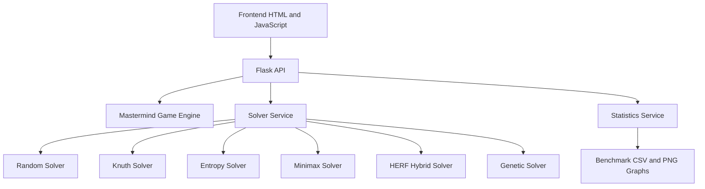

## Request Flow

The frontend sends guesses and solver requests to Flask. The API delegates game
evaluation to the Mastermind engine and solver requests to the solver service.
Benchmark data is read by the statistics service and rendered by the statistics
page.
